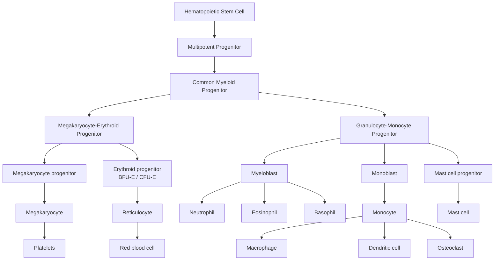
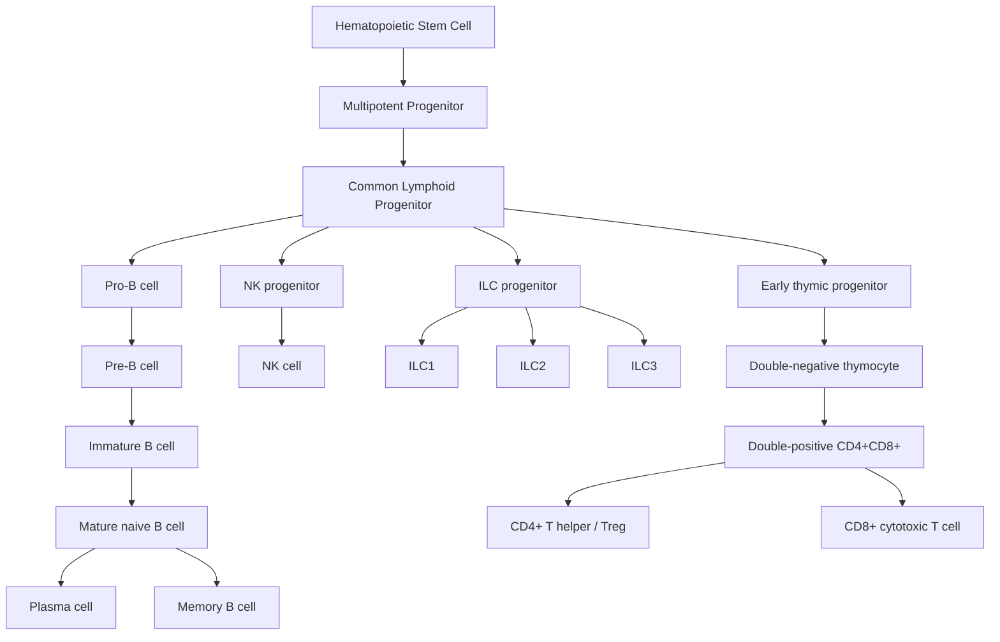

- **immunity** (חֲסִינוּת)

- **receptor** (קוֹלְטָן) 
- **antigen** (**Ag**) (אֶנְגָּד, אַנְטִיגֵן) – "A molecule or particle that the immune system recognizes as nonself. Triggers an immune response." [@Starr, 2014]
- **antibody** (**Ab**) (or **immunoglobulin** (**Ig**)) (נוֹגְדָן) 
	- "Y-shaped antigen receptor protein made only by B cells." [@Starr, 2014]

- **B-cell receptor** (**BCR**)
- **T-cell receptor** (**TCR**)
- **major histocompatibility complex** (**MHC**)

- **complement system** (or **complement cascade**, or just **complement**) (מערכת המַשְׁלִים)
- **cytokine** – type of protein

- **immune system**
	- **adaptive** (or **acquired**, **specific**) **immune system** (**AIS**) (מערכת החיסון הנרכשת)
		- **humoral immunity** 
		- **cellular immunity** (or **cell-mediated immunity**)
	- **innate** (or **non-specific**) **immune system** (מערכת החיסון המולדת)
		- **phagocyte** – type of cell

- **effector cell**
- memory cell
- **memory B cell** (**MBC**)

- **chemotaxis** (נְהִירָה כִּימִית)

- **fever** (or **pyrexia**) (חֹם)
- **inflammation** (דַּלֶּקֶת)
- **infection** (זִהוּם)

- **allergy** (אָלֶרְגִּיָּה, רַגֶּשֶׁת)
- **allergic diseases**
- **allergen** (אָלֶרְגֵּן)

- **autoimmune disease** (מַחֲלָה אוֹטוֹאִימוּנִית)
	 - autoimmune response
- **immunodeficiency** (or **immunocompromise**) (כשל חיסוני, חסר חיסוני)

- **immunization** (חִסּוּן, רכישת חסינות)
	- immune system process
- **vaccination** (הַרְכָּבָה, חִסּוּן)
	- administration of a vaccine to protect against disease
- **vaccine** (תַּרְכִּיב, חִסּוּן)
	- "a biological preparation that provides active acquired immunity to a particular infectious or malignant disease" (Wikipedia)

- surface barriers
	- physical barriers
	- biological barriers
	- chemical barriers
	- mechanical barriers

## White blood cells

- white blood cells
	- granulocytes
		- neutrophils
		- basophil
		- eosinophils
		- **mast cell** (or **mastocyte**, **labrocyte**) (תָּא פִּטּוּם)
	- agranulocytes
		- lymphocytes (לִימְפוֹצִיט)
			- T cells
			- B cells
		- monocytes
			- classical
			- intermediate
			- non-classical

- **antigen-presenting cell** (**APC**) (or **accessory cells**)
	- **professional APC**
		- dendritic cells
		- macrophages
		- B cells
	- **non-professional APC**

- myeloid lineage → 
	- [[Circulatory system#Blood|red blood cells]]
	- [[Circulatory system#Blood|platelets]]
	- mast cell
	- neutrophil
	- basophil
	- eosinophil
	- monocyte → 
		- macrophage
		- myeloid dendritic cell
- lymphoid lineage
	- lymphoid dendritic cell
	- plasma cell
	- natural killer cells (NK)
	- Natural killer T (NKT) cells
	- B cells
	- T cells

## myeloid lineage

## lymphoid lineage

# Viruses

- **virus** (נְגִיף)
- **viroid** (נְגִיפוֹן)
- **virion** (pl. **viria**, **virions**)
- **capsid** 

- **sheath** (נָדָן)
- **tail fiber** (סיב זנב)
- **pathogen** (מַרְעָן, פָּתוֹגֵן)
	- also called: **infectious agent** or **germ**
- **lytic cycle**
- **lysogenic cycle** (or **lysogeny**)

- **bacteriophage** (or **phage**) (נְגִיף הַחַיְדַּק)

- **virosome**

- **symbiosis** (צַוְתָּאוּת, סִימְבִּיּוֹזָה)
	- Types:
		- **symbiont** (צַוְתַּאי, סִימְבִּיּוֹנְט)
		- **mutualism** (הֲדָדִיּוּת)
		- **endosymbiosis** (צַוְתָּאוּת תּוֹכִית)
		- **commensalism** (סְמוּכָנוּת)
		- **parasitism** (טַפִּילוּת)
			- **parasite** (טַפִּיל)
	- **host** (מְאַכְסֵן, פֻּנְדְּקַאי)

- **epidemic** (מַגֵּפָה)
	- **epidemy**
	- **pandemic** (מַגֵּפָה עוֹלָמִית)

- **disease vector** (or **vector**) (מַעֲבִירָן, נַשָּׂא, וקטור פתוגני)
	- cf.: [[Genetics#misc|genetic vector]]

- **viral reassortment**
- **retrovirus**
